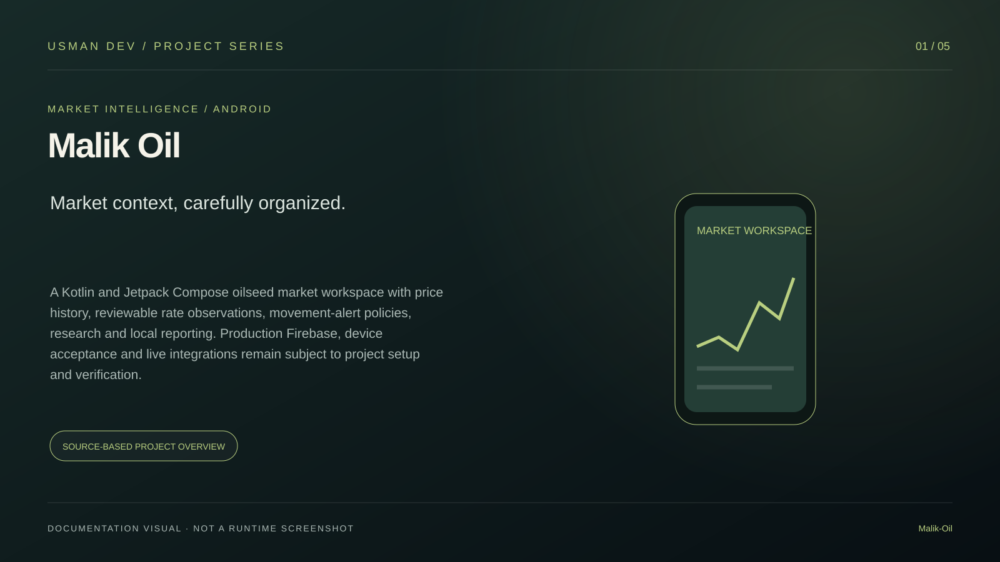
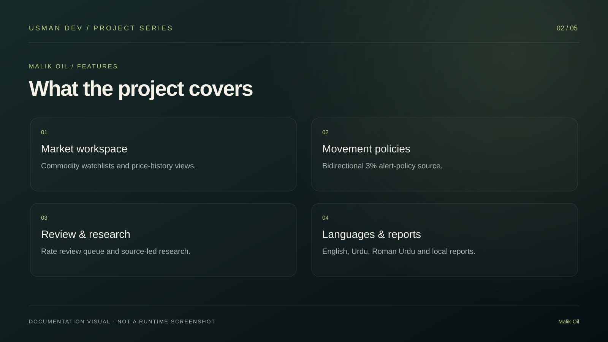
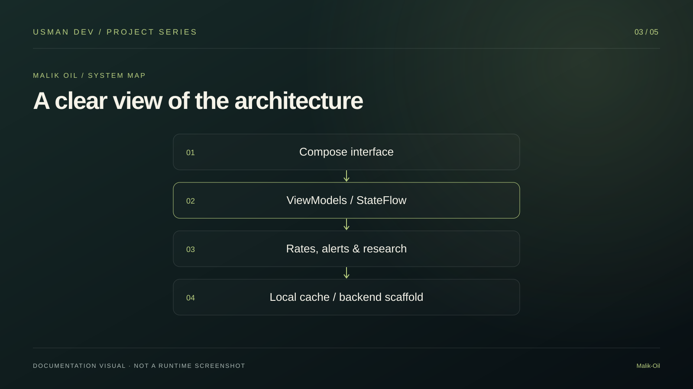
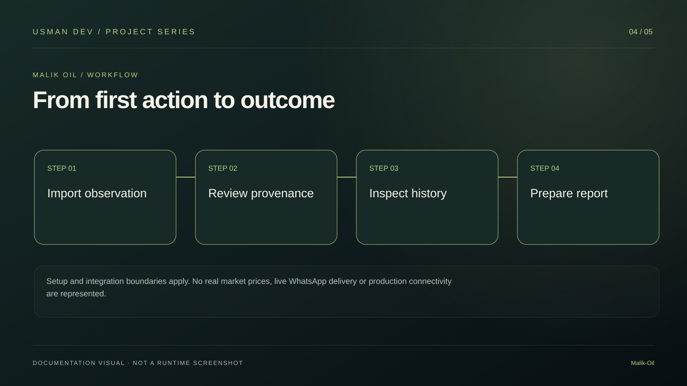
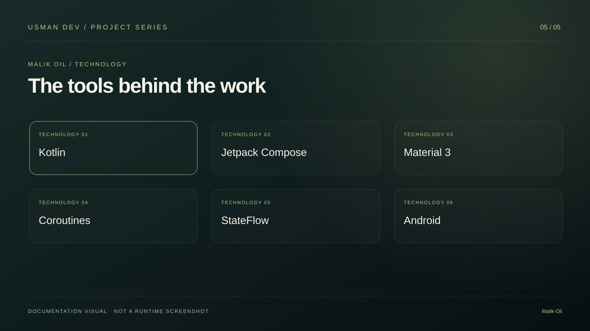

<p align="center"></p>

# Malik Oil · Android Market Workspace


## Visual project guide

A Kotlin and Jetpack Compose oilseed market workspace with price history, reviewable rate observations, movement-alert policies, research and local reporting. Production Firebase, device acceptance and live integrations remain subject to project setup and verification.

These five original illustrations summarize the documented project. They are **documentation graphics, not application screenshots or evidence of production readiness**.



| Features | Architecture |
| --- | --- |
|  |  |

| Workflow | Technology |
| --- | --- |
|  |  |

**Scope and verification:** Setup and integration boundaries apply. No real market prices, live WhatsApp delivery or production connectivity are represented.

[Developer portfolio](https://developer-folio-nov04-ab.glovedlark8.chatgpt.site) (ChatGPT sign-in required) · [Usman Dev](https://github.com/MalikUsmanAbid)

---


A modern native Android application built with Kotlin and Jetpack Compose (Material 3) for oilseed market rate intelligence, 3% movement alert policies, price history charts, conversational research, and daily reports in Punjab (Samundri, Faisalabad, Lahore, Multan, Gojra).

## Core Features

- **Market Watchlist & Trends**: Live observation stream tracking Sarson (Mustard), Canola, Til (Sesame), Taramira, and Alsi (Linseed) with prices in PKR/kg and 40kg (maund equivalent).
- **Interactive Price History Chart**: Custom Compose Canvas chart supporting 1D, 1W, 1M, and All timeframes with high, low, range change metrics, touch inspection tooltip, and CSV export.
- **±3% Movement Alert Engine**: Bidirectional 3% movement alert policy with deduplication suppression across matching commodity, mandi, grade, and source streams.
- **Candidate Review Queue**: Owner inspection queue for incoming rates before publishing to verified history, including WhatsApp shared text and pasted rows import.
- **Business Landed Cost Calculator**: Landed cost, revenue, gross margin, break-even per kg, and margin percentage scenarios.
- **Conversational Research Desk**: Source-led market research with structured findings, inline citations [1], dated sources, and evidence quotes.
- **Built-in Offline Plugins**: Rate converter (kg, 40kg, 100kg) and WhatsApp explicit row format validator.
- **Daily Reports & Notification Inbox**: Daily Excel report generator (18:00 Asia/Karachi schedule), report history snapshots, and local WhatsApp group notification reader simulator with priority town filters.
- **Trilingual Localization**: Instant switching between English, Urdu (اردو with RTL layout support), and Roman Urdu.

## Technology Stack

- **Framework**: Jetpack Compose with Material 3 Design
- **Language**: Kotlin 2.1 / 2.2
- **Build System**: Gradle 9.3.1 with Android Gradle Plugin (AGP) 9.1.1
- **Architecture**: MVVM with Kotlin Coroutines and StateFlow
- **Minimum SDK**: Android 8.0 (API 26)
- **Target SDK**: Android 15 (API 35)

## Building the App

Run Gradle to compile the debug APK:

```bash
gradle :app:assembleDebug
```

The compiled APK will be generated at:
`app/build/outputs/apk/debug/app-debug.apk`

## Developer contact

[Email](mailto:usmandev234@gmail.com) · [WhatsApp](https://wa.me/923157543808) · [Facebook](https://www.facebook.com/profile.php?id=61594398140960) · [GitHub](https://github.com/MalikUsmanAbid)
