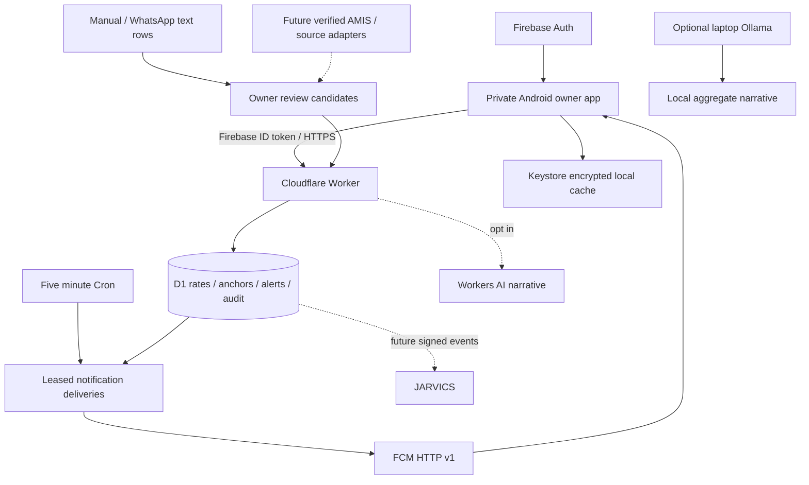

# Architecture and modular roadmap

## Runtime

Cloud deployment runs without Windows. Android connects directly to cloud; the laptop is an optional local AI workstation, never the required gateway. Kotlin uses native Android views for a small starter without a WebView. The API uses TypeScript, D1 and server-side OAuth signing. No service account secret ships in the APK.

## Data and provenance

`commodities` is the extensibility registry. `candidates` is the review queue. `rates` stores immutable approved observations: source label, source URL, observed and received UTC seconds, commodity, mandi, grade, normalized integer paisa/kg and content fingerprint. `anchors` maintains comparison baseline and latest qualifying timestamp per stream. `alerts`, `deliveries`, `devices` and `audit` capture alert history, retry state and owner actions.

A stream is commodity + case-normalized market + grade + source + PKR/kg. Different sources/grades are never silently compared as the same price series. UI preserves original labels. Add canonical market IDs and spelling aliases before broad automated ingestion. A 40kg quote is explicitly selected; a textual 'maund' is rejected. Unknown unit, range without an agreed midpoint, unclear date, OCR uncertainty and conflicting sources stay unapproved. Initial manual rates have owner-attested provenance, not independently verified accuracy. Source URL is recorded but never fetched by the API, avoiding arbitrary-URL fetching.

Rates older than 24 hours are stale. Dates with no time should be modeled explicitly in a later adapter, rather than assigned a fictitious live timestamp. Display source freshness and actual source coverage separately from backend availability. No fabricated sample rates load into the production database.

## Alert and delivery guarantees

See API rules for exact math. Quote insertion, baseline movement, alert insertion, notification intents and approval audit execute in one database transaction through a SQL trigger. This prevents concurrent requests from producing two alerts against one baseline. Import fingerprints and unique alert/rate constraints provide durable deduplication. There is no arbitrary cooldown that hides a qualifying reversal.

Each already-registered active device receives a unique delivery record per new alert. New devices see historical alerts in-app, without replaying all old notifications. Cron claims at most five deliveries with an atomic lease, sends minimal data through FCM and applies capped exponential backoff with jitter/Retry-After. Ten unsuccessful attempts terminate the row; delivery history exposes failure. Five-minute cron means notification dispatch is not instantaneous. Existing alert history is the source of truth after any missed push.

FCM delivery is at least once around crash boundaries: acceptance followed by a failed database update can resend. Android persists seen alert IDs and uses a stable notification tag to suppress repeated display; it cannot guarantee exactly-once display across uninstall, data clearing or all crash scenarios. Tokens marked UNREGISTERED are disabled. Successful submission is not device acknowledgement. Push contains only an opaque alert ID and generic text generated on the device.

## Security and recovery

Every data route verifies RS256 Firebase ID token claims and exact configured owner UID; no public signup UI, query-string token, unauthenticated ingest or dev bypass. Firebase REST signup may still be available for the chosen Auth provider: additional Firebase accounts never pass the backend UID allowlist. Protect the owner's password and enable supported account security; custom MFA/biometric unlock is future work. Restrict the public Firebase API key to intended APIs/app where supported; it is an app identifier, not a backend secret.

Tokens expire normally. To revoke existing sessions quickly, change `AUTH_NOT_BEFORE` to current epoch seconds and apply the configuration, then revoke Firebase refresh tokens/change the owner's password as appropriate. To block all access immediately, remove/change OWNER_UID. No automatic Firebase user-disabled/revocation lookup is implemented per request. The JWK cache follows library caching; Google key availability is a dependency.

Android uses HTTPS only, no backups, app-private storage and AES-GCM cache encryption with a non-exportable Android Keystore key. Cache is bound to the logged-in UID and cleared at signout; server 401/403/503 never falls back to cached data. Ordinary network failures can show an explicitly dated offline snapshot. Rooted/unlocked devices and an already-unlocked owner session remain outside this cache protection. Cache access has no biometric gate yet.

Audit includes approvals, candidate submissions, commodity changes, device registration and push results. It is application-level evidence, not tamper-proof against an account administrator. Raw access tokens, service credentials, phone numbers, full chats and FCM tokens never enter audit logs. Selected row payloads remain encrypted-at-rest by provider controls on cloud storage; there is no client-to-client end-to-end encryption for data the backend evaluates. Data residency is not pinned in this scaffold.

Protect Cloudflare/Firebase admin accounts, use a least-privilege FCM sender service account, keep its PEM only in Worker secrets and rotate on compromise. Export D1 plus signing-key backups to owner-controlled encrypted storage. Retention and automated backups are not enabled by default; choose an explicit retention period before live chat ingestion. Daily export and restore rehearsal are release gates. Add read-only usage monitoring before broad market rollout. Authenticated import bodies are capped at 64KB and 20 rate rows; this is not a complete abuse-control system. Public request quota exhaustion remains a Free-plan risk.

## AI and analytics

Rules handle normalization, threshold math and market aggregates deterministically. These are not called LLM inference. Optional laptop Ollama script can narrate aggregate JSON; optional Worker AI endpoint can narrate up to 30 approved quotes after explicit opt-in and model choice. No AI is enabled by default. Neither narrative can approve quotes, place orders, change alerts or access private WhatsApp text. Treat narratives as untrusted and validate their claims against source observations.

MVP business analytics include quote summaries and an authenticated landed-cost/gross-margin scenario calculator. These do not infer actual inventory, oil yield, net profit or receivables. Full business analytics needs the owner's transaction records and consistent costing choices.

## Phases and acceptance gates

| Phase | Deliverable | Acceptance gate |
|---|---|---|
| 0 · delivered scaffold | Manual/review ingestion, owner API, cache, alerts, notification code, margin API | Local tests pass; review status limitations |
| 1 · private pilot | Owner Firebase setup, cloud deployment after consent, signed APK, device verification | Correct owner succeeds; second account denied; live device gets rise/fall alerts and offline cache works |
| 2 · Punjab intelligence | Verified AMIS/web adapters; commodity/market alias registry; source health, conflict review, histories and trends | Captured source fixtures match dates/units; no stale page reported live; actual coverage list shown |
| 3 · hybrid AI/imports | Full export TXT/document picker, Urdu/Roman Urdu candidate extraction, OCR/voice, optional on-phone model | Owner confirms extraction; private chat content stays local unless explicitly selected for cloud processing |
| 4 · business operations | Purchases, sales, stock lots, weighted costing, expenses, debt ageing, oil/cake yield, break-even, daily digest | Reconcile totals against owner ledger and defined costing rules |
| 5 · integrations/distribution | Eligible official WhatsApp Business inbound webhook, JARVICS bridge, Play AAB | Verify Meta eligibility; HMAC signatures, replay protection, idempotency; Play policy/testing requirements met |

Additional proposed modules: stale-source warnings, source disagreement flags, mandi landed-cost comparison, commodity watchlists, stock exposure, daily digest and audit export. Trading decisions remain with owner. JARVICS currently has only an event schema; transport, endpoint and authority have not been invented. Future integration should be read-only first with explicit scopes and signed events.
